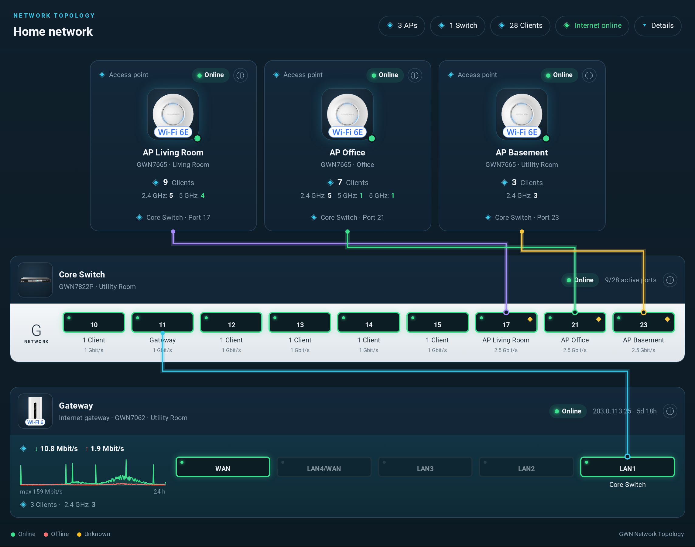
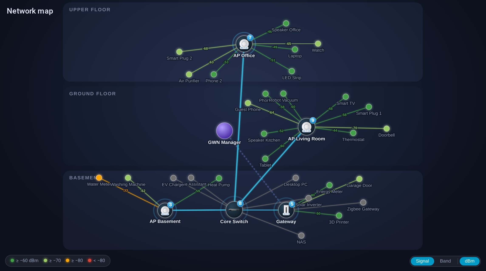
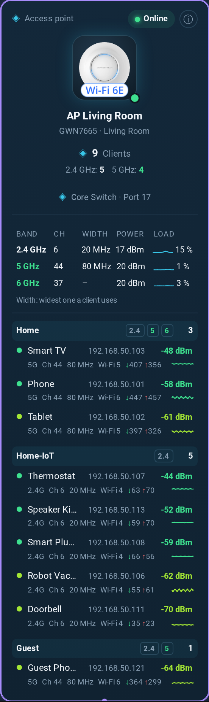
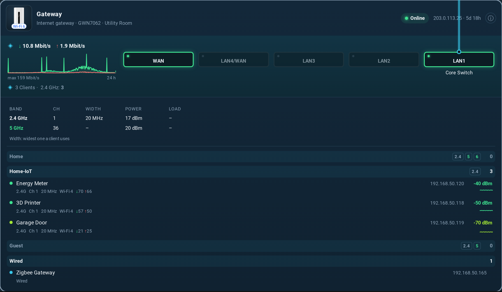
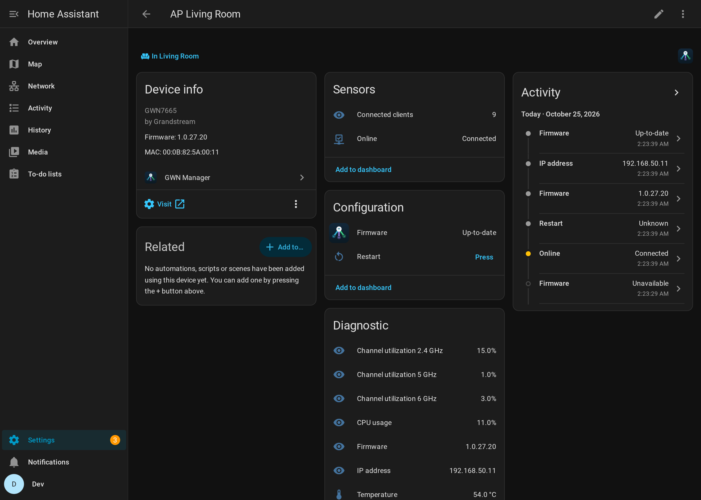
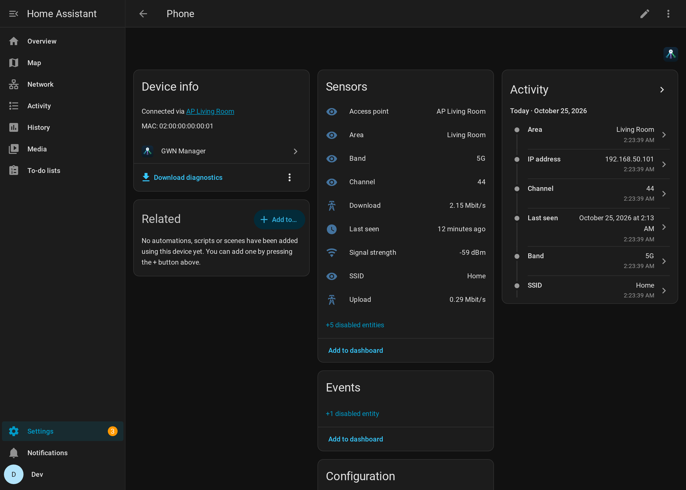

# GWN Manager for Home Assistant

Custom integration for **Grandstream GWN Manager** (self-hosted) and **GWN.Cloud**,
focused on the **clients** of your network: presence detection and per-client details
for every device connected to your GWN access points.

> Not affiliated with or endorsed by Grandstream.
> Looking for control of SSIDs / devices? Have a look at
> [Grandstream GWN Manager Bridge](https://github.com/shopsD/Grandstream-GWN-HomeAssistant-MQTT);
> both integrations can be installed side by side.



<sub>All screenshots use made-up demo data (see [Screenshots](#screenshots)).</sub>

## Features

- **Device tracker** per client (`home` / `not_home`), usable for presence and the `person` integration
- Per-client sensors: signal strength, access point, SSID, band, channel, last seen, IP address
  (disabled by default: connected since, link rates, traffic, VLAN)
- Clients are linked to the access point they are connected to ("Connected via"), following roaming
- **Area** sensor per client: the area of its current access point (assign areas to your APs for room-level presence)
- **Network access switch** per client (block / unblock), disabled by default
- Per access point / switch / router: online state, connected clients, uptime, firmware, IP address,
  temperature, CPU usage, channel utilization per band (disabled by default: memory, channel per band);
  sensors are only created for values the device model reports
- Timestamps are interpreted in the time zone configured for the GWN network
- **Wired clients** (once seen connected) attached to their switch or router, with a switch port sensor
- **Throughput** per client (download / upload), derived from the byte counters
- **Connection events** – connected, disconnected, roamed – on the event bus
  (`gwn_manager_client_connected`, `gwn_manager_client_disconnected`, `gwn_manager_client_roamed`),
  in the logbook and as event entity per client (disabled by default)
- **Switches**: link and PoE state per port, port link speed and throughput (disabled by default),
  total PoE power, CPU and memory
- **WAN** of the gateway: internet connectivity, download/upload throughput, WAN IP (disabled by default)
- **Firmware update** entity per device (installs the version GWN Manager recommends) and a **restart** button
- **SSIDs** as devices with the number of connected clients and a **Wi-Fi QR code** image
  (contains the password, so disabled by default)
- New clients and devices are added automatically
- Works with a local GWN Manager (self-signed certificates supported) and GWN.Cloud
- Diagnostics download with credentials redacted

## Network map card

The integration ships a live, interactive network map card – no extra resource needed.
Access points hang off the GWN Manager, clients off their access point; link length and
colour follow the signal strength, and clients float over when they roam.

```yaml
type: custom:gwn-network-card
title: Netzwerk          # optional
height: 450              # px
show_offline: false      # also show disconnected clients
show_labels: true        # show client names (false: only on hover)
animate: true            # gentle floating of the bubbles
color_by: rssi           # rssi or band (2.4 / 5 / 6 GHz); can also be switched on the card
show_rssi: true          # signal strength on the client links; toggle with the dBm button
appearance: auto         # auto (follows the Home Assistant dark mode), dark or light
device_images: true      # product pictures in the device bubbles (from the GWN Manager)
layout: auto             # floors, free or auto (floors as soon as an AP's area has a floor)
```

Assign your access points to areas and the areas to floors, and the map arranges the APs by
floor (highest floor at the top). The view zooms to fit automatically. Drag bubbles around, scroll to zoom, drag the background
to pan, double-click to fit again. Client names follow the device names you set in Home Assistant.
Hover for details, click to open the device tracker / AP status.



## Network topology card

<p>
  
  
</p>

Tap a device (or use **Details**) for its radios (channel, width, transmit power, load with a
24 h graph) and its clients grouped by SSID with signal, band, channel, width, Wi-Fi generation,
link rates and IP (click to copy).

Uplinks (which switch port each AP and the router are plugged into) are detected automatically –
the GWN API has no LLDP/MAC table, so they are derived from link speeds and device counts per port.
Override them in the integration options (`AP = Switch:17`) or on the card.

A structured view in the style of UniFi dashboards: access points with clients per band,
switches with their ports (speed, PoE, what is connected), the internet gateway with WAN
throughput, and uplink wires between them.

```yaml
type: custom:gwn-topology-card
title: Mein Netzwerk     # optional
appearance: auto         # auto, dark or light
show_all_ports: false    # also show switch ports without link
device_images: true      # product pictures of the devices (from the GWN Manager)
expanded: false          # show the details of all devices (also a button on the card)
graphs: true             # history graphs: internet, channel load, client signal
history_hours: 24        # time span of the graphs
uplinks:                 # optional override – the integration detects uplinks itself
  Living Room AP: Switch:17  # "<device>:<port>", or only the port number if there is one switch
  Office AP: 21
  Switch: Gateway:LAN1
```

Tap a device to select it: its uplink is highlighted and its connected clients are listed
(tap a client for details). The ⓘ button opens the device status. On narrow screens only the
selected device's wire is shown, routed along the side.

## Installation

### HACS (custom repository)

[](https://my.home-assistant.io/redirect/hacs_repository/?owner=digitalbirdo&repository=ha_gwn_manager&category=integration)

1. HACS → ⋮ → *Custom repositories* → add `https://github.com/digitalbirdo/ha_gwn_manager`, type *Integration*
2. Install **GWN Manager** and restart Home Assistant

### Manual

Copy `custom_components/gwn_manager` into your `config/custom_components/` folder and restart Home Assistant.

## Configuration

1. In GWN Manager / GWN.Cloud enable **System → API Developer Mode** and create an App ID and secret.
2. In Home Assistant: **Settings → Devices & services → Add integration → GWN Manager**
3. Enter
   - **Server URL**: your GWN Manager, e.g. `https://192.168.1.10:8443`, or your GWN.Cloud region, e.g. `https://eu.gwn.cloud`
   - **App ID** and **App secret**
   - **Verify SSL certificate**: turn off for a GWN Manager with a self-signed certificate

### Options

- **Presence update interval** (default 10 s, min 5 s): how often the list of connected clients is
  fetched. Connects and disconnects show up in GWN Manager right away.
- **Consider away after** (default 180 s): a client is only reported away after being disconnected
  this long, so phones briefly dropping Wi-Fi in standby don't flap. Arrivals are reported immediately.
- **Update interval for all other data** (default 90 s): offline clients, devices and device details.
  GWN Manager itself refreshes signal strength and other measurements only about every 90 s.
- **Only track clients of these SSIDs** (default: all)
- **Manual assignments**: one line per client, `client = device` or `client = device:port` (names or MACs),
  e.g. for devices behind an AP's LAN port, which GWN Manager attributes to the router
- **Track offline clients**: create entities for all clients known to GWN Manager, not only for currently connected ones
- **Remove clients after (days)** (default 0 = never): clients not connected for longer are removed
  with their entities and come back when they connect again. Clients that aren't connected can also be
  deleted by hand on their device page.
- **Fast updates via syslog / SNMP** (default off), see below

### Fast updates (syslog and SNMP)

GWN Manager passes on signal strength and link rates only about every 90 s. With these options the
integration also reads the devices directly; everything else still comes from the API, and a device
that doesn't answer simply stays on the API.

- **Syslog**: connects, disconnects and roaming show up within about a second. In GWN Manager set the
  syslog server to the Home Assistant host, UDP port **5514** (option *Syslog port*) and level
  **notice**. *Use debug events* additionally evaluates the detailed connect events (signal, rate,
  channel) that the devices only send at level debug – about four times as many messages.
- **SNMP**: signal (dBm), link rate and BSSID of every Wi-Fi client, every *SNMP interval* (default
  10 s) plus the poll itself, which takes about 10–15 s for a few APs. Enable SNMP v2c in GWN Manager
  and enter its read community (default `public`). Access points (GWN76xx) and routers (GWN70xx) are
  detected automatically; access points report the signal-to-noise ratio, which is converted with a
  noise floor of −95 dBm.
- The GWN API can't switch syslog or SNMP on – do it in GWN Manager under *System settings*
  (`<GWN Manager URL>/network/<id>/settings/system`; the options dialog links there directly). If the syslog port can't be
  opened, a repair issue says so and the integration keeps running without syslog.
- Diagnostics (`fast_sources`) show per device whether SNMP was detected and how many syslog events arrived.

## API notes

- Uses the GWN open API (`/oapi/v1.0.0`), see the [API documentation](https://doc.grandstream.dev/GWN-API/EN/).
- `client/list` with `untilNow: 1` returns all known clients without live values;
  `untilNow: 0` returns only connected clients but with RSSI, link rates, channel, etc.
  The integration merges both.
- Endpoints without parameters must be called without a request body; a signed `{}` is
  rejected with `Authentication Failure`.

## Entities

<p>
  
  
</p>

## Development

See [AGENTS.md](AGENTS.md) for the architecture, GWN API notes, conventions and how to run a
local Home Assistant test instance (`scripts/`).

## Releasing

1. Bump `version` in `custom_components/gwn_manager/manifest.json` and the version constants of
   both cards.
2. If the cards or entities look different now, update the [screenshots](#screenshots).
3. Push, wait for the **Validate** workflow, then create a GitHub release with the matching tag
   and a title with a short summary, e.g. `v0.5.9 – History graphs` (HACS shows the title).

HACS installs the integration directly from the tagged sources. (Zip release assets are not
used: GitHub's release download redirect currently sends a header larger than aiohttp
accepts, so HACS cannot download them.)

## Screenshots

The screenshots are taken from a local Home Assistant test instance connected to a **demo
server** with made-up devices, clients, SSIDs and IP addresses – never from a real network.
See *Screenshots* in [AGENTS.md](AGENTS.md) for the steps (`scripts/demo/`).

## Events

Example automation trigger:

```yaml
triggers:
  - trigger: event
    event_type: gwn_manager_client_roamed
    event_data:
      mac: "AA:BB:CC:DD:EE:FF"
```

Event data: `mac`, `name`, `ip`, `ssid`, `ap_mac`, `ap_name` and, for roaming,
`previous_ap_mac` / `previous_ap_name`. Disconnects are reported immediately; the device
tracker applies *Consider away after*.

## Limitations

- PoE can't be switched per port: the GWN API has no PoE setting for switch ports.
- Throughput and other measurements are refreshed by GWN Manager about every 90 seconds.
